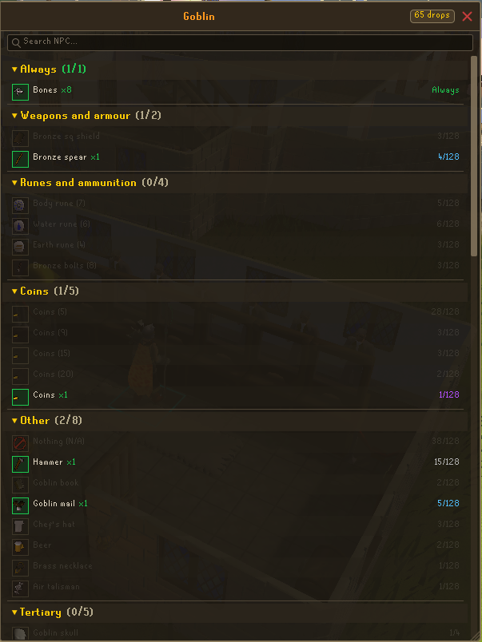

# Collection Log Expanded
## A better way to visualize your collection logs

## Features  
* Search Bar  
* Adjustable location, with location permanance  
* Collection Log, with tracking per enemy type  
* Counter for amount of times drop has been recieved  
* Collapsable Sections (Click # Drops to collapse all)  
* Side panel  
* Easter Eggs?  

## Update V1.1 - 05/18/26
* Added ability to resize window, to resize, hold Alt, and drag bottom right corner.
* Only enemies with a combat level show the "Collection Log" menu entry
* Ability to show Completion Count (change in settings)

## Update V1.2 - 05/19/26
* Ability to see your dry percentage (toggle)
* Show tracked killcount
* Toggle to require Shift click to see collection log option
* Opacity slider for background and foreground elements
* Fix clue scrolls
* Add color themes
* Removed "Nothing" drop
* Added "F2p" tag for drops only able to be obtained in F2p worlds
* Fixed graphical issue with "-", when item has a range
* Added ability to reset Cache manually
* Added ability to auto-collapse completed sections of log
* Added ability to automatically add all enemies you have seen to your drop log.

## Update V1.3 - 09/12/26
* Fixed OSRS Wiki API returning error 403 on all requests (the wiki was rejecting the plugin's User-Agent header)
* Fixed icon flickering when receiving a drop with the interface open (moved cache read/write off the game thread)
* Fixed missing hover tooltip on guaranteed ("Always") drops and a few other items
* Fixed obtained items not turning green in the floating overlay (was already working in the side panel)
* Added Collection Log support for the Lunar Chest (Moons of Peril) - more non-NPC reward sources may be added over time

## Planned Updates
* Better detection for enemies with multiple variants, such as Hobgoblins

If you have any ideas for a plugin, please let me know by either messaging me ingame @ "The Riptide"
or commenting on my reddit posts.

## FAQ
* Q: Why are some kills on an NPC not showing in the log?  
 A: You must first open a collection log for an NPC before you can populate it.
 - Enable "auto add enemies" to fix this from happening

* Q: How do I get rid of / reset a specific creature in my log?  
 A: To delete cache for NPC drop logs, go to \Users\\{Your Name}\\.runelite\collection-log-expanded  
  &nbsp;&nbsp;&nbsp;&nbsp;&nbsp;Delete any of the .Json files for the mobs you want to reset.

## Media - 
### Collection Log  
  

### Collection Log filled in with drops  

### Collection completion Count

## Credits -
***August Burns - Lead Engineer***  
***Usain Holt - Lead Designer***
